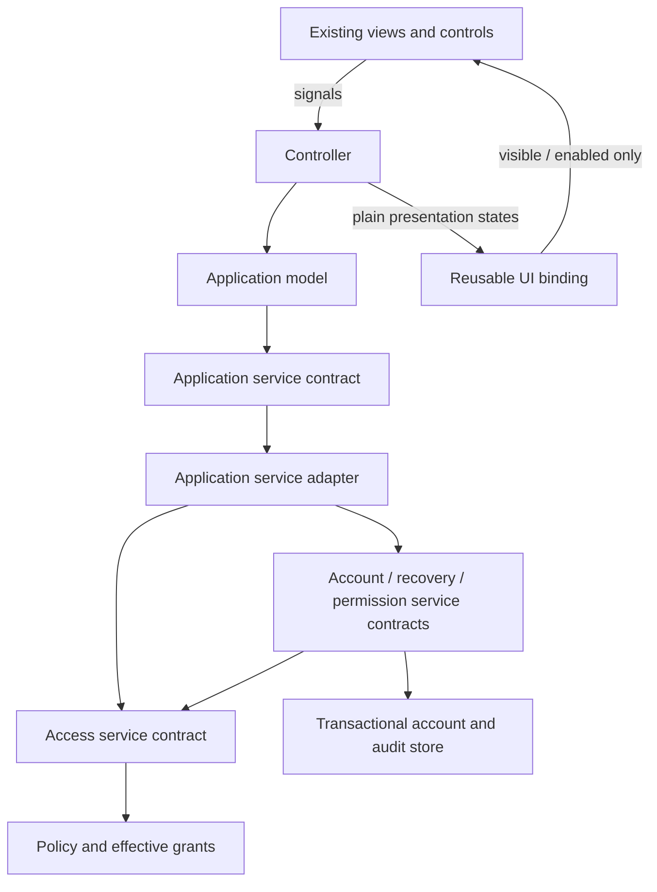

# Access control and account services architecture

The approved rollout is a clean cutover with fresh credentials/cards; preserving
old passwords is unnecessary because the systems are not in production. The
confirmed decision is to start with an empty account list. Bootstrap
must open an explicitly prepared installation. It must not fall back to CSV or
initialize missing established storage. Legacy account import was removed.

Status: shared access contracts, policy evaluator, query service, opt-in UI
bindings, typed account/permission services, SQLite persistence, transactional
audit, fresh setup, offline Admin recovery, application adapters and provider
wiring are implemented. The shell checks lazy/cached navigation asynchronously;
access changes affecting the current session require idle execution. Operator encryption, protected key-provider contracts,
explicit installation lifecycle, and shared runtime composition are implemented
and documented in the [credential guide](../engine/auth/credential_storage.md).
OS-authorized Manufacturer provisioning/reset is implemented in source and
documented in the [operational runbook](../engine/auth/account_recovery_runbook.md).
No live account data or application styling changed.

Implements the requirements in
[role_capabilities_and_password_recovery.md](role_capabilities_and_password_recovery.md).
That plan remains the source of agreed role behavior and open policy decisions.

## 1. Design boundary

All access decisions and protected account operations sit behind injected service
contracts. Applications depend on contracts, never storage, cryptography, a role
implementation, or a concrete authorization class. Implementations must be
replaceable without changing callers or their error handling.

Use small services with distinct responsibilities, composed into one runtime by
bootstrap. Do not create a single service with unrelated account, widget, storage,
session, and recovery responsibilities. A runtime bundle may carry references for
composition; it is not a global service locator and is not passed into views.



## 2. Contract locations and ownership

Proposed paths; add only the groups required by the initial implementation.

```text
src/shared_contracts/
  authorization/
    actions.py                 # shared action enums; domain groups can be split
    features.py                # meaningful visibility identifiers
    requests.py                # immutable request/context value objects
    decisions.py               # access decisions and presentation snapshots
    errors.py                  # stable error codes and service exception hierarchy
    results.py                 # typed success/failure unions
  accounts/
    records.py                 # safe summaries, revision and creation/edit metadata
    commands.py                # typed account/password commands
    events.py                  # redacted audit record and field changes

src/engine/auth/
  i_access_service.py           # visibility/action/app queries for current session
  i_account_service.py          # authorized account operations
  i_permission_service.py       # authorized permission administration
  i_recovery_service.py         # proof-based recovery; no ordinary session required
  policy/                      # pure policy evaluator and narrow rule handlers
  ...                          # implementations and adapters to existing contracts

src/engine/audit/
  i_audit_history_service.py    # authorized read-only history queries
  ...                          # durable storage adapter; no edit/delete API

src/applications/base/access/
  access_binding.py             # requirements and presentation coordination
  adapters.py                   # small adapters for buttons, tabs, QAction
```

Shared DTOs, enums, results, and errors use stdlib only. Engine service interfaces
may import those shared contracts, never application types. Application-owned
`IMyService` remains stdlib-only as required by AGENTS.md: declare its narrow
UI-facing DTOs locally and map shared results inside the application service
adapter. Models/controllers/views must not import engine service contracts.
Avoid leaking an engine exception across this application boundary; map it to the
application's documented result/error contract.

Consolidate small contract files if splitting would add navigation without a real
boundary. Do not expose repositories, raw database connections, session mutation,
or cryptography through the public service interfaces.

## 3. Small, explicit service surfaces

Illustrative method names and signatures, to be finalized with implementation:

| Contract | Responsibility / representative methods |
|---|---|
| `IAccessService` | `evaluate(request) -> AccessDecision`; `evaluate_many(requests) -> AccessSnapshot`; checks current session visibility, action, or app access |
| `IAccountService` | `list_users(query)`, `create_user(command)`, `edit_profile(command)`, `change_role(command)`, `change_password(command)`, `reveal_operator_password(command)`, `delete_user(command)` |
| `IPermissionService` | `read_permissions(query)`, `update_permissions(command)`; both Manufacturer-only initially |
| `IRecoveryService` | `generate_codes(command)`, `recover_admin(command)`; current Admin/password proof for issuance, saved code proof for recovery |
| `IAuditHistoryService` | `list_events(query)` with authorization, paging, and safe redacted records |

Account/permission/recovery methods return typed results. Each contract documents
its supported error codes, declared exceptions, audit behavior, idempotency,
concurrency semantics, and whether it can block. Mutations revalidate internally;
a successful prior `evaluate()` is never an authorization token.

No broad `update_user(record)` API carrying every field across the boundary.
Explicit commands prevent a profile edit from replacing credentials, forging
metadata, promoting roles, or restoring stale data. Creation accepts an initial
role and credential under explicit creation policy. Password commands contain
only the target and required proof/new credential. Account summaries never
contain credential hashes, ciphertext, recoverable secrets, or recovery material.

Actors come from the injected session. Normal callers cannot supply `actor_id`
or `actor_role`. Recovery and initial commissioning are separate verified flows;
they do not impersonate an ordinary logged-in user or bypass account service rules.

## 4. Typed results, structured errors, and exceptions

Use a tagged success/failure union. A failed result has no value, and a success
has no error. Do not use ambiguous `(bool, str)` tuples, untyped dictionaries,
or a result containing independent optional `value` and `error` fields.

Conceptual stdlib-only contract:

```python
@dataclass(frozen=True)
class Success(Generic[T]):
    value: T

@dataclass(frozen=True)
class Failure:
    error: ServiceError

# Result[T] is the public union of Success[T] and Failure.

@dataclass(frozen=True)
class ServiceError:
    code: ErrorCode
    message_key: str
    correlation_id: str
    field_errors: tuple[FieldError, ...] = ()
```

`ErrorCode` is stable and typed: `ACCESS_DENIED`, `INVALID_INPUT`, `NOT_FOUND`,
`ALREADY_EXISTS`, `CONFLICT`, `AUTHENTICATION_REQUIRED`, `INVALID_PROOF`,
`RATE_LIMITED`, and `POLICY_VIOLATION` are initial candidates. Add codes only when
callers need distinct behavior. Optional typed data such as retry-after duration
belongs in the relevant error variant, not an arbitrary metadata dictionary.

Expected business outcomes return `Failure`: permission denial, invalid input,
stale revision, or bad proof. An access query denying an action returns a normal
`AccessDecision(allowed=False, reason=...)`; it is not itself a failed query.

Use a small contract-defined exception hierarchy for an operation that could not
be reliably evaluated or completed: `ServiceUnavailableError`,
`StorageIntegrityError`, and `AuditPersistenceError` deriving from
`ServiceException`. Each carries a stable typed code, correlation ID, and safe
message key. These denote infrastructure failure, not permission denial. Do not
return the same failure both as a result and an exception depending on backend.

SQLite/I/O/crypto/library exceptions stay inside adapters and are chained for
internal diagnostics; no vendor exception or sensitive exception message reaches
the UI. Unexpected programming errors are logged at the application boundary,
become a safe unexpected-failure presentation, and are never converted to success.

Controllers translate stable message keys and safe parameters into English or
Bulgarian. They switch on typed codes, never parse exception strings. Detailed
diagnostics are associated by correlation ID without disclosing credentials or
storage paths. Public recovery/login failures deliberately avoid account/role
enumeration even if internal audit records have more specific reasons.

## 5. One policy, separate visibility and execution decisions

`AccessRequest` explicitly identifies request kind (`APP`, `FEATURE`, `ACTION`),
stable identifier, and an optional typed target reference. The service resolves
the target from trusted data; the caller supplies identity, not its claimed role.
Avoid one generic dictionary of arbitrary object attributes.

The pure policy evaluator takes an immutable trusted actor snapshot, request,
trusted target facts, and effective policy. It performs no Qt or database work.
Initially implement only the scopes actually needed: unconditional role grant,
own account, and target role. Use a small account-rule handler for compound rules;
do not build an expression language, policy DSL, or class for every permission.

Policy order:

1. Require a valid session for ordinary access and reject invalid/unsupported
   requests. Unauthenticated recovery goes through its own proof-based service.
2. Apply the Manufacturer global application/action/feature grant for supported
   operations. This grants authorization, not unsafe/unsupported behavior.
3. Apply immutable system restrictions for ordinary roles, including Operator
   denial of ADMIN/SERVICE apps regardless of editable app permissions.
4. Evaluate explicit role grants and target rules. Deny unmatched requests.

`CHANGE_PASSWORD` permits Admin on self or Operator targets. `REVEAL_PASSWORD`
permits Admin on Operator targets only. `APP_PERMISSIONS` feature visibility and
`permissions.manage` execution both permit Manufacturer only initially. Creation,
deletion, and role transitions stay denied until their unresolved policies have
explicit rules. No numeric role ranking or implicit Admin inheritance.

Keep action grants and feature visibility centrally declared with the system
policy. App permissions remain editable grants with the hard restrictions applied
after loading. Do not add a visibility identifier for every action button:
ordinary controls derive role-level visibility from action eligibility; explicit
feature IDs are for meaningful tabs/sections or a distinct presentation rule.

`AccessDecision` contains a bool, a typed safe reason, and current decision version.
For an action control, a presentation snapshot distinguishes role-level eligibility
from target-specific permission; it does not infer role denial from a missing
selection. No target yet means disabled while a role-eligible control can remain
visible. The UI never needs to reconstruct policy from reason strings.

## 6. Session and change lifetime

Construct one runtime session and policy instance per running platform and inject
the same instances into application services, navigation, and audit composition.
Extend existing bootstrap composition instead of constructing an unrelated auth
stack in each application factory. Adapt the existing `IAuthorizationService`
while migrating callers; do not keep two independent implementations of policy.

Track session generation and policy revision. Permission snapshots carry both,
plus the selected target/revision where relevant. Discard results from an old
session, policy revision, or target selection. Publish change notifications through
the existing messaging abstraction; they invalidate UI state but do not grant
authority. Engine services re-read current state regardless of notifications.

At protected execution, verify current account status/role and credential/session
version, not just the role stored at login. Recheck these in the mutation's
transaction to close the authorization/write race. Long-running operations capture
the verified actor for audit and reauthorize any later protected commit; do not
attribute a background operation to whoever logs in afterward.

Confirmed active-operation policy: reject changes affecting the current session
until idle. `IAccessChangeGuard` reserves the shared process manager through
commit and checks the domain activity hook. Unknown activity is unavailable.
Busy recovery does not consume its code. Permission writes also require idle.
Independent UI gates never replace these service checks.

The shell polls storage/session validity and authorizes every lazy/cached opening
in workers. If a session is invalidated, defer view cleanup until both domain
activity and screen-owned work are idle. No access component stops robot motion.
Offline maintenance uses the same database runtime lock and cannot mutate
accounts while the platform is active.

## 7. Reusable presentation adapters

Bindings own requirement declarations and state composition, not authorization.
The controller receives plain application-level access states from the model and
applies them to the coordinator. Application adapters map shared service results
to those local DTOs; the model remains Qt-free.

Each binding tracks separate inputs:

```text
visible = ordinary_visibility AND role_visibility
enabled = visible AND action_allowed AND operational_enabled
```

For a display-only feature, `action_allowed` is not required. For action controls,
operational state includes selection validity, validation, and busy state. Existing
callers must migrate their enabled/visible updates to explicit binding inputs;
do not rely on intercepting arbitrary `setEnabled()` calls or reading the already
combined widget state back. During staged adoption, keep bindings opt-in.

Hide role-ineligible controls by default; disable temporary/target-specific denial.
Support explicit visible-but-disabled and hide-on-target-denial presentation.
Tab adapters address page widgets, never numeric indices, and handle selection
fallback. Protected page construction/data loading is deferred until permitted.
Recheck before page activation and handle revocation. Parent visibility never
substitutes for child action authorization.

Adapters set only visible/enabled state. Existing classes, style sheets, labels,
icons, geometry, and translation mechanisms stay intact. No mandatory button
subclass or common base class for every Qt widget. Factory lifecycle starts/stops
the binding coordinator; broker subscriptions and Qt bridges follow repo patterns.

## 8. Durable account history and interchangeable persistence

The existing `ActionRecorder` is best-effort diagnostics: it deliberately swallows
logging failures. Retain that behavior for troubleshooting. It cannot provide the
required durable user history or guarantee an audited account change.

Use the approved SQLite transaction boundary for accounts, credentials,
permissions, recovery consumption, and audit events. SQLite is available through
stdlib and directly solves consistency between updates and history. This is a
selected backend choice, not a requirement leaked into callers. A replacement
backend must pass the same transaction, concurrency, and contract tests.

Use internal store operations that apply a typed mutation and audit event in one
transaction. Inject clock, ID generation, and credential protection where tests
need determinism; do not expose a generic public unit-of-work framework. Schema
design should separate profile/metadata, secret credential material, grants, and
append-only events. A technical UUID identifies an account independently of its
reusable login ID. Keep an increasing account revision for conflict detection.

Command flow:

1. Capture request/correlation identity and resolve the current session.
2. Validate typed input without logging secrets.
3. In a transaction, load current actor/target, validate session and expected
   revision, authorize, apply the operation, and insert redacted audit history.
4. Commit. Only then return `Success` and publish invalidation notifications.
5. If commit/audit persistence fails, roll back and raise the documented service
   exception; do not return a successful mutation without its history.

Password reveal records its authorized audit event durably before returning the
secret. Denied/failed attempts use separate redacted attempt events and do not
change account metadata. An audit failure cannot turn a denied action into an
allowed one. History is immutable through application APIs, even for Manufacturer;
this is not a claim of tamper resistance against a privileged operating-system
administrator. Define retention/backup operations separately from account editing.

Retries use an optional command idempotency key for mutations where needed; reuse
is scoped to verified actor, command type, and payload identity. Secret-bearing
inputs/outputs must not be retained as generic request/response logs. Conflicting
account revisions return typed `CONFLICT`, never silently replace newer fields.

Cutover creates an explicit empty installation with fresh accounts and grants.
It imports no legacy CSV/JSON credentials or identities. Repeated setup preserves
new accounts, and missing established storage is an integrity error. Encryption
key/backup provisioning remains an explicit rollout prerequisite.

## 9. Reuse and replacement rules

To add a new protected operation:

1. Declare a stable action ID in the appropriate shared or app-owned group.
2. Define a typed command/result where the operation needs one.
3. Add policy for non-Manufacturer roles, with target scope if necessary.
4. Enforce it inside the owning service; bind existing controls for presentation.
5. Add the allow/deny, direct-call, error-mapping, and audit tests.

To add a new UI component type, add a small adapter for applying presentation
state; do not change policy or domain services. To replace policy or persistence,
provide a new implementation through composition and pass contract tests; do not
change UI code or inspect concrete backend types at call sites.

Provide isolated stub services matching the same contracts for standalone apps.
Test implementations honor deny/failure behavior as well as happy paths. No
hardware connection is required to test these services.

## 10. Implementation slices and contract validation

1. Shared DTO/error/result contracts; pure account policy and action/feature tests.
2. Typed service boundaries and adapters for current application/navigation callers.
3. Transactional storage and audit; safe credential/account migration tests.
4. Existing-button and tab bindings; Manufacturer-only App Permissions pilot.
5. Account workflows, recovery, session invalidation, then all robot-system wiring.

For each swappable service, run the same contract suite against an in-memory test
implementation and the real backend. Verify exact result/error semantics, no
vendor exceptions crossing boundaries, rollback on audit failure, actor attribution,
conflict handling, and consistent role/target authorization. Presentation tests
force a forbidden control visible and invoke the service to demonstrate the
independent execution gate. Compare allowed screens to the current styles.

The current implementation uses `IAccessService.evaluate(tuple[AccessRequest, ...])`
to return a typed snapshot, `IAccessContextProvider` for trusted snapshots, and
`IAccessPolicy` for interchangeable pure policy. `IAccessCondition` supports
domain-owned restrictions without engine edits. `AccessBinding` has widget/action
and tab adapters; controllers supply plain UI access states and version tokens.
`ISessionService.snapshot()` now provides an atomic user/revision read; login and
logout advance the revision even when the same account logs in again.
`IAccountService` and `IPermissionService` are implemented with explicit commands,
safe summaries, and typed results. `SQLiteAccountStore` implements the internal
store contract; `AccountOperationRunner` handles trusted authorization and audit
consistency. `AccountInstallation.initialize_new()` prepares the empty store;
legacy migration contracts/helpers were removed. Details and rollout limitations are in
[Account services and durable history](../engine/auth/account_services.md).
`IRecoveryService` issues/redeems personal Admin codes with persistent retry limits
and transactional code replacement, password reset, and audit. Manufacturer's
authenticated account service supplies the fallback when the Admin loses both
password and codes. Login and user management use these services; final shell
invalidation, Twin activity reservations, maintenance packaging and disposable
handover are implemented; physical station acceptance remains deployment work.
