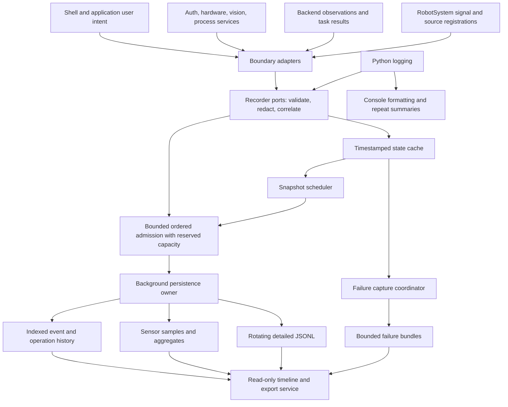

# Machine history, telemetry, user actions, and diagnostics plan

Status: implementation started on `feature/machine-observability`; Gate H is in progress.
Date: 2026-10-21.
Initial deployment target: `paint_tray_dry`; shared infrastructure must support other RobotSystems.
Architectural constraint: paint is the first integration, not the recorder's domain model.

### Implementation progress: first Gate H slice

The engine recorder is now an optional lifecycle service exposed through
`EngineContext.diagnostics_service`. Platform JSON supplies `diagnostics.enabled`
with a 0/1 environment override; omission of the engine capability uses a no-op.
Disabling takes effect on restart and skips recorder files/workers and inline
evidence work. Compatibility-log capture and structured console projection have
separate switches; the latter defaults off without reducing persistent detail.
This does not yet replace legacy artifact/backend logging policy. Startup reports
capture state, and an enabled session records its policy; disabled intervals have
no recorder history and must never be interpreted as verified inactivity.

Resource hardening now skips payload copying/tracebacks on saturated ingress and
uses a bounded, explicitly opted-in dataclass traversal rather than pre-copying
all Paint settings. Local samples reduced default raw/effective settings capture
from about 2.0 ms to 1.4 ms median; ordinary event admission was about 14 µs median.
These observations do not satisfy the deployment performance gate. Phase 8 must
still compare representative control/acquisition/UI timing with capture enabled
and disabled under load, including writer GIL/CPU use, memory, disk growth and
overload recovery. Item queue bounds are not a hard RSS budget.

A first read-only file timeline is available via `python scripts/diagnostics.py`.
It merges retained engine JSONL and the configured system's existing failure index,
with time/ID/severity/source filters, readable fields, optional tracebacks/bundle
links and live following. The engine reader remains system-independent. This
delivers usable presentation before the indexed Phase 2 timeline; it does not
provide new capture coverage, transactional joins or migration of legacy artifacts.

Implemented in the dedicated engine diagnostics module: bounded primitive ingress,
pre-enqueue accounting validation, optional-field omission that preserves valid
output transitions, per-record writer savepoints/staged state, sequenced admission
loss epochs, direct structured recording and a separate bounded console projection.
Pump command diagnostics use the direct path. Paint trajectory export/analysis
admission is bounded before snapshot copying and releases capacity on completion,
failure or cancellation. Both reviewed recorder reproductions are regression tests.
Verification: 51 targeted diagnostics, pump, trajectory, paint failure-bundle and
failure-register tests passed; touched Python modules compiled and whitespace checks
passed. Tests use temporary storage and mocked hardware. This is evidence for the
implemented slice, not completion of every guarantee in this plan.

Gate H remains in progress: verify reserved admission and all boundary/soak cases,
finish artifact lifecycle/shutdown ownership, and address limits of terminating
arbitrary external console handlers. This slice does not implement indexed machine
history, user/sensor wiring, schema redaction or the timeline pilot. Checklists below
remain acceptance requirements, not claims that planned capabilities already exist.

## 1. Intended outcome

Given a machine and a time range, support must be able to reconstruct:

- Who was logged in, which screens they entered, which actions they requested,
  and whether those actions completed, failed, were rejected, or were interrupted.
- Machine, robot, vision, hardware, and production state, including freshness.
- Commands requested and accepted, independently of physical feedback.
- Sensor measurements and relevant transitions before and after a failure.
- Cycle/operation timings, backend responses, errors, and related artifacts.
- Any missing history caused by sampling, overload, restart, or storage failure.

Developers must be able to display selected timings and diagnostic streams live
without enabling every component's debug output. Production capture must retain
useful evidence even when the console is quiet and the machine is offline.

Capture is automatic and continuous for successful, rejected and failed operations;
it never depends on an operator marking/reporting an issue. Every retained cycle
has its step outcomes/timings, relevant actions, configuration/workpiece identity
and available signal/state observations. Failure capture adds detail rather than
being the trigger for ordinary history. Select a time range after a customer call,
including when software considered every operation successful.

Absence of an error is not proof of correct physical behavior. Exports distinguish
recorded success, uninstrumented signals, stale/missing observations, recorder
loss and expired evidence, with actual coverage and recorder-health history.
Acceptance includes a customer-reported quality/performance issue in a nominally
successful cycle, investigated solely from automatically retained evidence.

This is an operational support history, not a certified safety recorder or a
tamper-proof compliance audit. It never replaces safety checks or command results.

## 2. Existing foundation and gaps

| Existing location | Preserve and extend | Gap to address |
|---|---|---|
| `src/bootstrap/logging_config.py` | Central logging startup | Console/root verbosity and persistent capture need independent policy |
| `src/engine/diagnostics/runtime.py` | Bounded asynchronous writer, rotating JSONL, SQLite metrics, lease, status | INFO-only ingress, one shared queue, limited history querying and signal policies |
| `src/engine/diagnostics/events.py` | Structured `observe()` and `diagnostic_context()` | Versioned typed records, actor/action identity, explicit worker propagation |
| `src/engine/diagnostics/report.py` | Consistent SQLite backup and support ZIP | Time-range timeline, backend inclusion, signals, failure artifacts, completeness manifest |
| `src/engine/hardware/vacuum_pump/vacuum_pump_controller.py` | Output-write events and commanded-state statistics | Correlate commands with independently observed feedback and sensor samples |
| `src/engine/auth/user_session.py` | Injected, thread-safe session ownership | Authentication session IDs, actor snapshots, session transition observations |
| `src/bootstrap/shell_session_controller.py` | Login/logout orchestration and navigation veto handling | Record actual session results and blocked logout requests |
| `pl_gui/shell/AppShell.py`, `folder_controller.py` | Shared navigation and application lifecycle | Semantic requested/completed/rejected/failed signals |
| `src/shared_contracts/events/vision_events.py` | Existing vision state topics | Inventory actual payloads/readiness semantics; do not equate a frame with readiness |
| `src/robot_systems/paint/diagnostics/` | Failure register, bundles, trajectory artifacts | Preserve backend rejection, pre/post-event context, links to common history |

The copied `storage/diagnostics/temp_logs` is an investigation input, not a log sink.
The earlier `get_status` source throttle suppresses persistent records too; migrate
repetition suppression to destination policy. Existing lifetime metrics and output
accounting must remain compatible during migration.

### Review-driven prerequisites

The 2026-10-21 deeper review identified implementation defects that change the
order of work. Source inspection confirms the boundaries below; the reported
64-test run and reproductions are reviewer evidence, not tests run by this plan.
Do not interpret passing existing tests as coverage of these failure modes.

| Finding | Required plan change |
|---|---|
| R1: Invalid metric exits the persistent writer | Pre-enqueue semantic validation and per-record transactional isolation |
| R2: Serialization rejection loses output certainty without reporting loss | Unified rejection/loss accounting across every pipeline boundary |
| R3: Save can partially persist resources | Parent action plus per-resource outcomes/revisions; no implied rollback |
| R4: Loader returns fallback widgets on failure | Explicit load-result contract independent of display success |
| R5: Caller serialization and artifact submission are unbounded | Pre-format limits, primitive-only data and bounded worker admission |
| R6: Reused backend has no inherited capture; child descriptor cannot be rotated by parent handler | Separate capture/rotation ownership for launched and external backends |
| R7: Backend has existing request/error/task contracts | Adopt agreed request IDs and structured errors; verify queued context separately |
| R8: Exhausted sensor reads return a legitimate boolean value | Record acquisition success/quality, not just detection result |
| R9: Image writer can return false without raising | Validate artifact result and cycle ownership; report partial bundles |

Complete Phase 0's hardening-only inventory and the recorder-hardening gate before building
new history on the current runtime. Loader, Save, sensor and backend contracts
must be specified before their instrumentation phases begin.

## 3. Architecture and ownership



### Platform

`src/engine/diagnostics/` owns contracts, validation/redaction, state cache,
recording policies, buffering, persistence, retention, queries, and exports.
This existing dedicated engine module is the implementation home; do not introduce
a parallel recorder package in a RobotSystem or a second competing diagnostics stack.
It contains no RobotSystem imports, paint/glue/welding-specific signal IDs, Qt
dependencies, or physical I/O. Core storage, queries and export must work without
importing any concrete RobotSystem, application or backend implementation.

Proposed module responsibilities (names may be adjusted during implementation):

| Module | Responsibility |
|---|---|
| `contracts.py` | Frozen record types, enums, schema version, correlation/actor data |
| `ports.py` | Narrow recorder, signal registration, snapshot, query interfaces |
| `recorder.py` | Validate bounded payloads, redact, assign IDs, route observations |
| `context.py` | Context capture/restore and immutable actor snapshots |
| `signal_registry.py` | Signal definitions and sampling/freshness policy validation |
| `evidence_registry.py` | Explicit provider registrations and generic evidence schemas |
| `capture.py` | Generic failure-capture coordination, completeness and artifact ownership |
| `state_cache.py` | Latest observed values, quality, age, and reconstruction inputs |
| `console_filter.py` | Console-only selection and bounded repetition summaries |
| `runtime.py` | Lifecycle, queue ownership, writer health and orderly shutdown |
| `storage/` | Versioned SQLite migrations, indexed history/samples, rotating detail |
| `retention.py` | Independent budgets, pruning, capture pinning, low-disk behavior |
| `query.py`, `report.py` | Time-range history, state-as-of queries and support exports |

Use focused components through composition; do not grow `DiagnosticsRuntime`
into the owner of authentication, sensor acquisition, UI logic, and storage logic.
Recorder ports have null/in-memory implementations for isolated tests.

The module table defines responsibilities, not a requirement to build every module
before the first useful release. Implement the narrow end-to-end milestone in
Section 11 first; extract additional components as their responsibilities are used.

### Recorder admission and persistence results

Make these distinct API contracts, not a single success boolean:

- `AdmissionResult`: `rejected` with classified reason/loss effects, or `queued`
  with immutable origin ID and optional receipt handle. Admission performs bounded
  validation/enqueue only. Queued does not mean committed or durably recorded.
- `PersistenceReceipt`: asynchronous `committed` with commit position/time and
  duplicate disposition, or `persistence_failed` with error and known/unknown
  commit outcome. Shutdown/crash before confirmation leaves an unresolved receipt;
  it is not proof of rejection. Per-record writer rejection also resolves the
  receipt as failed and applies the loss policy.
- `query_receipt(origin_id)` / retry of the same origin: reconcile uncertain
  acknowledgement using the transactional origin ledger. A post-commit delivery
  failure must not be interpreted as permission to repeat metric effects.

Control and GUI paths never block awaiting commit or run subscriber callbacks
inline during recording. Deliver receipt notifications outside writer/control locks
through a bounded dispatch path; callers may also query asynchronously. Bound live
receipt handles/subscriptions, expire them explicitly, and retain authoritative
outcomes in the ledger for the supported replay horizon. Ordinary Python logging
may remain fire-and-forget, with recorder health exposing its losses.
Document the configured SQLite durability/flush semantics behind `committed`;
commit acknowledgement is not a promise of survival against every hardware failure.

### Failure containment at instrumentation boundaries

Recorder rejection, serialization/redaction failure, adapter exception, receipt
dispatch failure or diagnostics shutdown must not change an existing hardware/
service result, replace the original exception, or skip required cleanup. Direct
typed recording and logging compatibility both obey this rule. Protect each
instrumentation boundary with bounded best-effort adaptation and an independent,
non-recursive health/loss path; never log a recorder failure back into itself.
Capture the original outcome before reporting it, and preserve its traceback when
re-raising. A secondary instrumentation error is supplementary evidence only.
Do not accidentally swallow an original hardware/safety exception while protecting
the observer. No retries or additional device writes may be caused by recording.

Fault-inject rejection and exceptions at intent, outcome, finally/cleanup, worker
completion and receipt notification boundaries. Assert unchanged return values,
original exception identity, command count/order and completed cleanup. Include
the new direct recorder path, not just `logging.Handler.emit()` compatibility.

### Independence from synchronous logging

Critical typed observations enter the recorder port directly, without routing
through `Logger.log()`, synchronous handlers, console formatting or handler locks.
The current pump calls `observe()` while holding its command lock and `observe()`
uses Python logging; an asynchronous database writer alone does not bound that path.
Use a minimal direct adapter for existing control-accounting observations in Gate H;
do not require the entire future event/receipt architecture to fix this boundary.

Console output for typed events is a separate bounded, best-effort delivery path.
It cannot run inline on command, recorder admission or writer threads. A stalled
console must not delay typed recording, command completion or writer progress.
Do not call ordinary synchronous logging in migrated critical sections either,
including error paths. Queue bounded primitive summaries or render them outside
the command path. Moving a slow handler just outside the lock is insufficient if
the command still waits for it before returning.

Console transport owns its blocking I/O and has explicit drop/health behavior and
bounded shutdown independent of console progress. Do not use an unbounded executor
or rely on cancelling a blocked thread. Test with a deliberately stalled console
handler in an isolated test process: command/output observations and subsequent
commands complete, hardware serialization/order remains correct, recording continues,
and shutdown does not join the stalled console indefinitely. Existing ordinary
noncritical log calls remain a compatibility path without a real-time guarantee.

### RobotSystem

The RobotSystem composition root registers available signals and connects
adapters to actual services. A shared signal catalog supplies common semantics;
system-owned registrations supply device IDs, units, freshness and policies.
Shared paint wiring stays in shared paint composition; tray-only definitions stay
in the tray system. Discover actual acquisition ownership before changing wiring.

RobotSystems also register evidence providers through a generic registry. Wiring
uses explicit constructor injection and registration in composition hooks; no
global discovery singleton or `if system == "paint"` branches in the core.
Source/evidence registration returns lifecycle handles owned by the RobotSystem.
Optional/missing services produce declared unavailable evidence without requiring
every system to implement pressure, vision, workpiece or any other optional domain.

Shared device adapters live beside shared hardware services or in shared diagnostics
integration modules. Process-specific providers live under their owning RobotSystem
packages. Glue and welding can reuse a pump adapter without depending on paint.

### Generic process-evidence extension contract

The shared failure-capture model contains neutral sections:

| Section | Generic meaning |
|---|---|
| `subjects` | Zero or more items involved: workpiece, joint, batch, assembly or other subject |
| `configuration` | Complete raw/effective configuration snapshots used by the operation |
| `execution` | Plan, submitted commands, stage and confirmed/unknown progress |
| `observations` | Signals, state, freshness and operation timings |
| `errors` | Primary and secondary failures and linked original exceptions |
| `artifacts` | Typed images, geometry, trajectories and other bounded attachments |
| `manifest` | Provider/schema versions, time coverage, dependencies and completeness |

`subjects` is not a required single `workpiece` field. Workpiece type, paint contour,
glue bead and welding seam are domain payloads supplied by their owners.

Proposed narrow contracts:

- `EvidenceProviderDefinition`: namespaced provider ID, versioned schema ID,
  declared evidence kinds, availability, resource limits and redaction policy.
- `EvidenceContribution`: immutable metadata plus owned snapshot/artifact references,
  source times, correlation IDs and explicit availability/completeness results.
- `IProcessEvidencePublisher`: publishes prepared immutable evidence at the owning
  system boundary. The recorder stores it under provider/run/operation identity;
  capture reads that registry without calling domain code. The core receives no
  concrete paint execution context.
- `ArtifactDescriptor`: media type, schema/format version, checksum, size, capture
  time, provenance, ownership and retention dependency; large bytes are not log fields.

Choose passive retrieval of already-published contributions, not callback collection
with thread timeouts. Providers freeze relevant configuration/subject evidence at
selection or operation start and publish updates at explicit boundaries. Failure
coordination reads owned immutable registry entries and assembles them asynchronously;
it never invokes provider methods, lazy serializers or artifact-loader callbacks.
An unpublished/stale contribution is explicit missing evidence, not a reason to wait.

Core publication validates bounded primitive metadata and owned artifact handles.
Expensive domain preparation is owned and admission-bounded by the source adapter,
outside control locks. No untrusted domain task may run in the recorder's worker
pool or be a shutdown dependency. Any future on-demand/hanging provider execution
requires a separate isolation design (for example a terminable process with bounded
work); timing out a Future does not terminate its thread. Shutdown drains only
bounded core work and never joins a provider's arbitrary code. Independent providers
and the primary failure therefore remain recordable even when one never publishes.

### Evidence registry memory and ownership

Passive publication also has resource limits. Before Phase 1 registry work, set global/per-provider
retained bytes, maximum active run/operation identities, contribution count/size,
replacement versions, reader leases and pending artifact references. Include cache,
registry and receipt memory in the producer/runtime budget, not only queue depth.

Publish only bounded owned immutable metadata and explicit artifact handles. Copy
mutable camera/array/domain data at the source's admitted preparation boundary;
never retain caller-owned buffers, live context objects or closures. Prefer a
managed artifact handle for large data instead of multiple in-memory copies.
Publication returns admitted/rejected status and the assigned contribution version.

Replacement atomically changes the current pointer; an existing capture lease
continues to refer to its exact older immutable version. Count leased versions
against the budget and release them only after consumers finish/expire. Evict
unleased superseded versions, then eligible completed/inactive identities; never
evict a referenced version silently. If all capacity is leased, reject/defer the
new contribution with explicit missing/stale evidence rather than grow memory.
Cap lease lifetimes and abandoned active identities, reconcile orphan references
on operation close/restart, and preserve pinned artifact dependencies on disk.
Failure metadata may still record a new incident even when evidence admission fails.

### Published evidence durability and crash recovery

Publication admission is not durable evidence. Return contribution identity/version
and `rejected` or `published_volatile`; provide asynchronous persistence status for
metadata and each artifact dependency separately. An operation may proceed before
these commit. The timeline must not label volatile evidence durably captured.

Track a bounded publication manifest through metadata-pending, dependencies-pending,
complete, failed or interrupted states. Register pending artifact intents in the
database, write owned artifacts to reserved staging, verify content/checksums and
publish atomically, then commit the final references/completeness state. Follow
documented file/directory flush and SQLite durability policies; filesystem and
database updates are not a single atomic transaction. Complete evidence means its
metadata and all required dependencies reached the configured durable state.

On restart, reconcile committed pending manifests, staging files, published blobs
and references before normal pruning. Resume only safe idempotent core work;
otherwise mark interrupted/missing/corrupt, then reclaim orphan data under bounded
budgets. If an operation record survived but publication existed only in memory,
report evidence-not-committed/unknown, not a fabricated complete snapshot. Include
expected evidence kinds and contribution IDs/receipt states in the outer operation
record where available so missing evidence is discoverable. After durable acceptance,
artifact dependencies remain protected by the existing retention/lease rules.

Exports list metadata and dependency commit status individually, missing expected
evidence and recovery results. Never substitute current settings or another cycle's
workpiece to fill a lost snapshot. Verify crashes before metadata commit, between
metadata and artifact commit, after blob publication but before reference commit,
and after complete commit. Machine execution does not wait for this evidence pipeline.

Use stable namespaced schemas such as `paint.process_evidence.v1`,
`glue.process_evidence.v1` and `welding.process_evidence.v1`. Validate the shared
envelope centrally and domain payloads at their owning providers. Unknown domain
schemas remain exportable and generically viewable as structured fields/artifacts;
optional specialized viewers must not become capture dependencies.

| Integration example | Domain-owned contribution; examples are not existing capabilities |
|---|---|
| Paint | Workpiece, contours, paint recipe/settings, pass/segment, capture and path |
| Glue | Workpiece/batch, dispensing recipe, bead path, available flow/pressure/weight |
| Welding | Assembly/joint, welding procedure/settings, seam path, available current/voltage |
| Future system | New provider/schema and source registrations using unchanged core contracts |

Register only evidence actually available from the installed services. Namespace
domain payloads without adding domain columns or tables to the core for every system.
Use capability/schema version negotiation for future changes, preserving old exports.

### Applications and shell

Before adding navigation instrumentation, define a loader-to-bootstrap
`ApplicationLoadResult` contract carrying requested application ID, outcome,
fallback/placeholder status, error reference, and the actual widget. Preserve shell
decoupling through neutral lifecycle signals or an adapted factory result.
`application_loader.py` currently converts factory/register/widget failures into
ordinary `AppWidget` fallbacks; widget display/cache success is therefore not proof
the requested application loaded. Record load outcome and fallback display outcome
separately, retaining requested versus displayed identity. Include missing apps,
factory/register/create/load failures, cached fallback reopening, and retry behavior.

- Views expose semantic signals; they do not import diagnostics or log business outcomes.
- Controllers own user intent and UI validation outcomes; models remain free of Qt.
- Route action observations through the model and app-owned service boundary.
  If needed, add a narrow app-owned reporting contract using only stdlib types;
  the concrete application service adapts it to the platform recorder.
- Preserve the existing controller/model/service import rules. Do not inject
  concrete engine recorders directly into views, models, or controllers.
- Services report validation, persistence, and hardware outcomes; processes report
  asynchronous completion. A generic decorator must not guess success from a
  boolean/`None` return without that method's explicit contract.
- Shell framework changes are explicitly in scope for semantic navigation hooks.
  `pl_gui` emits Qt signals with neutral IDs/results; a bootstrap adapter records
  them. `pl_gui` must not import engine diagnostics or authentication services.
- Use named bound callbacks, strong adapter ownership, and matching unsubscribe/
  disconnect on stop. Application factories retain controller lifetime ownership.

## 4. Record contracts and semantics

### Common envelope

All persisted record kinds share:

- `schema_version`, `event_id`, `kind`, stable `event_name`, severity, source/device ID.
- Source occurrence UTC, collector receipt UTC, source-local monotonic time,
  source boot/session ID, and per-source sequence number.
- Machine ID, RobotSystem/profile, platform/backend release and configuration identity.
- Applicable application session, auth session, actor, action, operation, run,
  cycle, backend task, parent operation, and causation IDs.
- Bounded typed fields, outcome, error reference, and sampling/quality metadata.

UTC supports cross-process timelines; monotonic time measures local durations.
Never compare monotonic clocks across machines/process boot domains. Record
clock adjustments and available synchronization information. Event occurrence
may arrive out of order; preserve receipt order and source sequence as evidence.
Assign an origin event ID once when an observation is created, before delivery.
Preserve it and its immutable payload across buffering, retries, reconnects and
uncertain acknowledgements, including source restart when retry state survives.
Collector delivery IDs are separate and never serve as observation identity.
Use a unique origin namespace/source epoch plus event ID or sequence as the
deduplication key; a repeated key with a different payload is a conflict, not an update.

Persist duplicate detection in the same SQLite transaction as history insertion,
metric increments, output accounting and lifecycle changes. Apply in-memory effects
only for newly committed observations. A duplicate may update bounded delivery
diagnostics but never count the original metric/transition twice. Acknowledge durable
acceptance only after commit; crash/retry after an uncertain acknowledgement uses
the same origin key. Derived JSONL/export copies are not the deduplication authority.

Before Phase 2, define the maximum replay horizon and a deduplication ledger retained at
least that long, independently of event-detail pruning. Reject/quarantine replay
outside that supported horizon or from an expired epoch explicitly; do not process
it as a new observation after its deduplication key has been pruned. This is bounded
idempotence, not a claim of exactly-once transport or unlimited replay support.

Keep metric labels bounded: cycle IDs, user IDs, task IDs and file paths belong
in records, not metric names or unrestricted metric dimensions.

### Record kinds

| Kind | Examples and meaning |
|---|---|
| State transition | Backend starting → ready; vision ready → degraded with reason |
| User action | Save requested; navigation blocked; Start accepted |
| Operation lifecycle | Pickup started/completed/failed, duration and phase timing |
| Command | Pump ON requested/write succeeded/failed; requested output is not physical state |
| Signal observation | Pressure sample, input transition, output readback, measurement quality |
| Snapshot | Aggregate cached state with each member's source time and quality |
| Error | Original exception/traceback or backend rejection, referenced by other records |
| Diagnostic detail | Planning decisions, bounded payloads, selected debug traces |
| Recorder health | Queue loss, storage failure/recovery, unclean shutdown, retention truncation |

### Action and operation lifecycle

Create an outer operation identity and immutable initiating-actor snapshot at the
service entry boundary, before configuration loading/scaling, readiness checks or
cycle-context construction. This boundary records attempted execution even if no
domain execution context can be created. Carry its operation/run/attempt identity
into later contexts; creating `PaintExecutionContext` must not create an unrelated
replacement identity or duplicate operation-start event.

For paint, `run_cycle_result()` can return an invalid-configuration result or fail
tray readiness before `PaintExecutionContext` exists. Instrument the outer boundary
to record these returned failures/rejections and unexpected exceptions, original
error references, timing and unavailable/not-yet-selected evidence. No workpiece,
recipe or cycle snapshot is assumed to exist. Preserve existing return/exception
and safety semantics. Domain failure-bundle handling enriches the same operation
when context exists; it is not the only path capable of recording a failure.

`started → succeeded | rejected | failed | cancelled` for synchronous actions.
An asynchronous request may produce `started → accepted`; its linked operation
then has its own start and terminal outcome. Acceptance is not machine completion.
Record timed-out work as timed out/outcome unknown unless cancellation or failure
is confirmed. Reconcile incomplete lifecycles after restart as interrupted/unknown;
never invent a successful terminal result.

Distinguish the current operator, initiating actor, and system automation. Capture
the actor at initiation and pass it explicitly to workers and backend requests.
A later login/logout must not reattribute an earlier action. Login failures have
an unauthenticated actor; authentication bypass and automatic actions are explicit.
Record denied/vetoed requests and attempted navigation, not only successful paths.

Setting edits, Save requests, validation, persistence, and effective runtime
application are separate events when those stages exist. Record canonical
before/after values for persisted changes, not every keystroke. Retries receive
distinct attempt IDs linked to the original action. Do not log passwords, tokens,
credentials, arbitrary user-object payloads, or unbounded form contents.

A multi-resource Save is a parent action with one child persistence outcome per
resource. `RobotSettingsModel.save()` currently writes configuration, movement
groups, calibration and optionally targeting sequentially. Preserve this behavior:
report each attempted/succeeded/failed/not-attempted resource with prior/resulting
revision or content identity and effective-application status. A failed parent
tracks resource content outcome separately as `unchanged`, `changed`, `corrupted`
or `unknown`, with verification time/method and error. A write exception does not
prove old content survived: the existing JSON writer opens the destination with
`w` before `json.dump()` finishes and can leave truncated/invalid JSON.

Report the previous revision as preserved only when verified. Readback/content
verification runs through the owning persistence service outside control/GUI locks;
if concurrent writes prevent attribution, record unknown rather than claim certainty.
Record requested content identity separately from observed persisted identity.
`partial_persistence=true` includes a partially changed/corrupted first resource,
even when no resource saved successfully. Unknown side effects make the parent
state uncertain (`partial_persistence=unknown`), not falsely unchanged/false.
Never infer rollback. Atomic file replacement and multi-resource transactions
are separate behavioral fixes requiring their own scope and verification.

#### Persisted-content inspection contract

Add a service-owned read-only `inspect_persisted(resource)` operation backed by a
repository inspection port, separate from normal `get()`/`reload()`/`load()`.
`SettingsService.get()` can return cached values; repository `load()` returns
defaults for corrupt JSON and may create defaults when a file is missing. Neither
is valid evidence of the persisted bytes or of a failed write's side effects.

The inspection result distinguishes present/readable raw content identity and
bounded content snapshot, JSON parse failure, schema/conversion failure, missing
file, I/O failure, oversize or concurrently changing/unknown content. Include
inspection time, path/resource identity, byte hash/size and verification scope.
Read/hash/parse one owned byte snapshot subject to size limits; do not hash one
read and validate a different file revision. Report cache/runtime configuration
identity separately, including whether it came from defaults or a prior revision.
Do not substitute defaults, create/repair files, update the cache or apply settings
as a side effect of inspection. Redact exported content while retaining identity
and explicit redaction metadata. Application code uses its service boundary;
controllers/views must not inspect repository files directly.

Readback can establish observed content integrity, not guaranteed power-loss
durability or attribution across concurrent writers. Unknown verification stays
unknown. Test corrupt JSON with a valid cached/default object and verify inspection
still reports actual corruption, then test missing, unreadable and changed files.

### Errors

Unexpected exceptions retain bounded exception chains and tracebacks once at the
owning failure boundary. Propagating layers reference the same `error_id`.
Validation rejections retain field/reason/code without a fabricated traceback.
Backend rejections preserve backend code, message, task and relevant response.
Record secondary cleanup/stop failures without overwriting the primary failure.
Truncation must be marked; large diagnostic data belongs in linked artifacts.

## 5. Signals, sensor acquisition, and state reconstruction

### Persistent-input redaction policy

Redact before persistent queues/storage, not only when building a support export.
Apply the same policy to structured fields, compatibility logs, errors, backend
responses, configuration snapshots and artifacts. Each adapter/logger category has
an explicit allowlist/schema and policy version; preserve operational IDs, legitimate
process settings and useful timing without copying arbitrary object/request content.

| Input | Before persistence | Additional export treatment |
|---|---|---|
| Typed records | Schema-approved fields; strip credentials/tokens/secret values, bound nested content | Optional user/site identifier pseudonymization |
| Ordinary log messages/arguments | Allowlisted logger/template adapters, bounded primitive arguments and approved text sanitization; unsupported messages become metadata plus omitted-body reason | Do not reintroduce omitted raw content |
| Exceptions/tracebacks | Exception type/code and bounded sanitized message/chain/frame metadata; no locals or arbitrary object repr, redact sensitive paths/source text | Optional path/site anonymization |
| Backend responses | Map approved response/error fields; never dump authentication headers, URL credentials or arbitrary response bodies | Contract/version and omission metadata retained |
| Complete configuration | Domain serializer defines legitimate settings versus secret-bearing fields, including nested/unknown-field handling; capture actual used identity separately | Redacted content plus policy/omission manifest |
| Images/other artifacts | Explicit source policy and resource admission; exclude unsupported sensitive artifacts before storage | Further approved masking/exclusion where applicable |

Pattern scrubbing is defense in depth, not proof arbitrary free text contains no
secrets. Unclassified compatibility inputs do not get an unrestricted raw-persistence
fallback. Record redaction/omission/truncation and schema mismatch explicitly; a
secret redaction must not silently drop an entire valid output transition. Capture
raw persisted settings inspection identity separately from redacted export content.
Backend stdout/file logs have their own owner-side sanitization policy: local raw
fallback files are not safe merely because the support exporter redacts them.
Document unsupported legacy log coverage while migrating; do not claim it sanitized.

Test canary secrets in message arguments, exception text/chains, nested config,
headers/response bodies and unsupported objects. Verify they never enter managed
persistent files or staging and that exports add stricter filtering where configured.

Each `SignalDefinition` declares ID, device, value type, units, meaning, source,
freshness limit, sampling policy, retention class, schema version and availability.
Reject duplicate incompatible definitions. Registration does not imply hardware
exists, is healthy, or has already produced a reading.

Initial catalog:

| Signal/domain | Policy and semantic distinction |
|---|---|
| Pump | Requested state, write result, register readback and physical feedback separately |
| Pressure/vacuum | Raw unit/conversion, periodic/change samples, threshold crossings, quality |
| Workpiece/digital input | Every observed edge with acquisition/debounce identity |
| Vision | Camera connected, frame freshness, calibration available, processing readiness separately |
| Robot | Connection, drives, collision observer readiness, execution state and last rejection |
| User | Login/logout, auth mode, role and session; action initiator retained independently |
| Production | State, active cycle/step, pause/stop reason and outcome |

Subscribe to the existing acquisition owner or add observation at every completed
acquisition outcome, including exhausted retries. Do not introduce competing
serial/Modbus polling or reread hardware
from snapshots. Logging a sensor does not justify new physical I/O implicitly.
If pressure is not exposed by the installed sensor, record unavailable; do not
infer a pressure value from a binary vacuum switch.

For `VacuumSensorService`, use `get_read_diagnostics()` as the starting contract:
read sequence, source timestamps, attempts/retries, success, raw value and error.
An exhausted read returns `False`, which must not be recorded as confirmed vacuum
absence. Preserve the last successful value independently and mark the failed
acquisition's quality/error. Capture diagnostics atomically with the owning read
or return a paired result so concurrent callers cannot associate another read's
diagnostics with their own boolean.

Cover exceptional acquisition exits as well as exhausted retries. The current
`_reconnect_transport()` call inside the retry handler can raise before final
read diagnostics are recorded. The acquisition owner must publish a paired failed
outcome with read sequence, attempt durations, reconnect stage and original error
for that exit; retain last-known value separately. Do not turn the escaping exception
into a successful False or alter existing transport/retry behavior as instrumentation.
Test reconnect failure, read/conversion exceptions and concurrent read association.

Current vacuum acquisition is demand-driven. Declare observation coverage and
active acquisition intervals; idle periods may contain no readings. Maximum
sampling gaps and continuous physical edge capture cannot be promised without a
separately designed acquisition policy. Any new continuous polling is an explicit
hardware scheduling change, not a side effect of enabling diagnostics.

Analog policy combines maximum rate, significant-change deadband, maximum sample
gap and observed threshold crossing capture. Preserve quality changes regardless
of deadband. Optional bucket min/max/count summaries expose excursions lost by
downsampling; they cannot recover phenomena the acquisition never sampled.
Digital edges use explicit device debounce rules, not console throttling. Document
acquisition rate versus retention rate and the shortest events that can be observed.

Quality includes valid, stale, unavailable, invalid, unknown, and explicitly marked
simulated data. Keep last-known value and timestamp separately from current quality.
A sensor reconnect/reset starts a new source epoch where appropriate.

State snapshots occur at startup, cycle/operation boundaries, failures and a
configurable heartbeat. They are collections of differently aged observations,
not atomic physical measurements. Persist checkpoints plus transitions so queries
can reconstruct state at interval start. Pruning must retain a usable baseline or
report unknown; never silently carry state across an unobserved restart/gap.

Persist signal definition revisions and effective intervals with sample references
so old values remain interpretable after unit, threshold or calibration changes.
Historical reconstruction uses accepted/persisted evidence, not the newest cache
alone: distinguish observed, queued and durable positions. A cache value newer
than stored history must not fill an unrecorded interval silently. Define ordering
for delayed samples, loss markers and snapshots, and test restart, late arrival,
clock changes and pruning/pinning interaction before claiming state-as-of accuracy.

## 6. Persistence, retention, and resource limits

### Mandatory recorder-hardening gate (R1, R2, R5)

Before expanding collection, harden the existing producer/writer path:

- Validate structure and semantics before enqueue: finite timestamps/numbers,
  valid output tuples, bounded stable metric names, and metric-specific ranges.
  Existing additive metrics reject negatives; do not apply that constraint to
  legitimate signed sensor values such as pressure or temperature.
- Accept only explicitly supported primitive values and bounded containers in
  producer records. Enforce depth, item count, string/byte and total payload
  budgets before full serialization. Bound context, metrics and errors too.
  Do not call arbitrary `str()`, `repr()`, `tolist()` or iterable hooks. Snapshot
  owned domain objects through explicit adapters outside timing-critical paths.
- Bound message arguments and exception frame/chain data before rendering. Do not
  format entire messages/tracebacks or serialize/deserialize unlimited payloads
  on the caller, then claim truncation makes the work bounded. Do not retain live
  traceback frames indefinitely. Define a separate bounded compatibility path for
  ordinary Python logs; strict machine-history producers use typed observations.
- Separate mandatory control-accounting facts from optional diagnostic fields.
  If optional detail is invalid, preserve a valid command transition with an
  explicit omitted-field/rejection marker. Reject semantically invalid records
  atomically; do not partially apply their metrics or mutate in-memory accounting.
- Isolate producer-data failures per record in the writer using validated staging
  and transaction/savepoint boundaries. Roll back record-local database changes
  and apply in-memory state only after record acceptance. A malformed record must
  not terminate the writer or corrupt a later valid record. This does not imply
  atomic commit across SQLite and JSONL; reconciliation/completeness covers that.
- Treat serialization, semantic validation, oversize, queue admission and writer
  rejection as classified loss paths. Increment bounded counters by reason/class
  and preserve a non-recursive recorder-health signal through a reserved path.
  Storage I/O failure is a different fault domain with explicit persistence
  degradation/recovery; it must not be retried as malformed producer data.
- When any lost/rejected record could contain an output transition, invalidate
  affected accounting before the next duration calculation, not just at a later
  checkpoint. Use a bounded loss epoch/marker independent of ordinary queue
  admission so an OFF at a later timestamp cannot extend an uncertain ON interval.
  Preserve only demonstrably confirmed segments; mark the gap and never silently
  convert uncertain runtime into certain lifetime totals. If affected output
  identity cannot be trusted, conservatively invalidate all active outputs.
- Bound artifact admission by queued count and estimated bytes before copying
  paths/images. Include the existing trajectory export executor in budgets,
  ownership, result reporting and shutdown drain/cancellation. An executor's
  worker count alone does not bound queued submissions or snapshot memory.

Gate regression cases: negative metric followed by a valid record; ON at t=0,
OFF at t=4 carrying unrelated NaN, then OFF at t=10; nested/oversized context and
metrics; adversarial formatting objects; sustained artifact submissions and
shutdown backlog. Verify no false ten-second confirmed ON total, visible loss or
omission, live writer after bad data, atomic record rejection, bounded work/memory
and continued persistence of valid records. Optional-field omission that preserves
the OFF transition must retain the correct four-second accounting instead.

Extend the existing single writer with indexed SQLite tables for events, action/
operation lifecycles, snapshots and retained signal samples. Preserve existing
lifetime statistics and output accounting through versioned migrations.
Do not duplicate every debug line into SQLite: detailed JSONL remains a bounded
stream, referenced by time/source/event IDs. Keep sensor samples separate from
lifetime metric aggregates so their retention can differ.

Suggested initial policies, to tune from measured production volume:

| Data | Target age | Independent resource policy |
|---|---|---|
| History, actions, operation summaries | 30 days | Size cap; retain reconstruction baselines |
| Detailed traces and high-resolution sensor samples | 24–72 hours | Per-class byte budgets and source rates |
| Lower-resolution sensor aggregates | 30 days | Bounded buckets and dimensions |
| Failure bundles | 30 days | Independent quota, bounded pre/post-event captures |
| Lifetime counters | Across releases | Transactional migration and backup |

Age targets are not guarantees when byte limits are reached. Report actual oldest
available timestamps, pruned intervals and capture completeness. Measure bytes/day
before choosing final deployment budgets. Do not store operational evidence only
under `/tmp` or inside a replaceable source checkout. Use the existing diagnostics
directory precedence and configured persistent machine-data root.

### Storage arbitration and admission

Hard resource ceilings and minimum free space take precedence over target ages
and new capture/export requests. Pinning is a bounded lease, never unlimited storage.
Before Phase 2 storage work, fix numerical limits and select database maintenance thresholds using
measured load; the following arbitration rules are mandatory:

1. Account for SQLite allocated files, WAL/SHM, rotating logs, evidence blobs,
   staging/incomplete files, managed exports and active reservations under a total
   budget. Count shared blobs once while retaining reference/lease dependencies.
   Reserve estimated temporary/peak bytes before capture/export admission, not just
   final archive size. External user copies are outside managed quota and must not
   be deleted by retention; filesystem free-space checks still cover their impact.
2. Maintain a configured free-space reserve and separate bounded headroom for
   operational history/recorder health. Use bounded SQLite transactions, WAL growth
   controls/checkpoints and an explicit reclamation policy. Row deletion alone does
   not reclaim database file space. Configure incremental reclamation at database
   creation/migration or schedule maintenance with bounded duration/temp-space;
   never launch unreserved full VACUUM during low-disk capture.
3. Limit simultaneous captures/exports, outstanding artifact bytes, per-capture
   pre/post windows and maximum lease duration. Admission failure returns a reason
   and partial/refused status. Reserve a small failure metadata record independently
   of large artifact admission; disclose if even that path cannot persist.
4. Reclaim expired staging/leases and unpinned detail first. Evict oldest eligible
   sealed bundles/exports as whole dependency sets. Do not delete files in active
   export/capture leases or break references silently. New captures may shorten
   post-event windows/omit optional artifacts within their reservation; record every
   omission. If still inadmissible, refuse the new large capture/export rather than
   displace a previously admitted active operation or consume protected headroom.
5. Leases expire and jobs have bounded lifetimes. On timeout/failed progress, cancel
   cooperative core work, finalize or mark partial, close readers and release leases
   before reclamation. Never leave permanent pins after crash/restart. If external
   disk consumption threatens the free-space reserve, stop new admissions and abort
   exports/optional captures before degrading critical history; mark resulting gaps.
   No mechanism promises continued recording on a full or failed filesystem.

Failure storms cannot create unlimited bundles: coalesce repeat evidence references
while retaining bounded failure metadata, enforce admission limits, and report
refused/shortened captures. Test this with a concurrent export and SQLite WAL growth;
verify actual allocated bytes, leases, reference integrity, and recovery after restart.

Reserve bounded capacity for critical state/action/error records independently of
bulk debug/sensor traffic. Queue saturation sheds/coalesces eligible detail first;
record per-source/class loss counts and intervals. Even reserved capacity is finite.
Never silently drop metrics used for output/lifetime accounting; retain the current
uncertainty invalidation behavior when their observations are lost.

### Causal ordering under reserved capacity

Gate H and the pilot use one ordered ingress/writer stream with reserved admission
capacity, not independently drained priority queues. Assign collector ingress order
at the same sequencing boundary as admission/loss marking; preserve original source
order for accounting transitions. Reject eligible bulk detail before it consumes
the critical reserve, but never let a later critical event overtake an admitted
earlier transition. Apply a source's loss epoch before its next accounting update.
An out-of-band loss marker must be reconciled at that boundary, not merely flushed
at a later periodic checkpoint.

Any later multi-queue scheduler must dispatch only causally eligible stream heads:
priority can choose between independent streams, never reorder transitions, their
loss markers or declared parent/child prerequisites. Late/missing remote sequence
data must be buffered within limits or marked as an explicit gap before dependent
accounting; timestamps alone cannot resolve it. Test ON/OFF/loss sequences with
mixed severities, concurrent producers and saturation. No multi-queue optimization
ships before these ordering tests pass; a simple ordered queue remains acceptable.

All producer paths have bounded serialization work and payload sizes. No disk,
network, backend lookup or arbitrary snapshot provider runs under a control lock.
The background writer owns storage and retention. Define transaction/flush policy
and measurable maximum uncommitted window; accepted into memory is not durable.
Use bounded shutdown drain, explicit unfinished-session records and crash recovery.
On disk-full or corruption, surface degraded diagnostics without blocking control;
use a bounded emergency path and mark unrecoverable gaps. Recovery is deliberate
and tested, rather than an endless recursive logging/retry loop.

## 7. Failure capture and backend correlation

Failure capture pins the affected interval before normal rotation can prune it.
Capture configurable pre-failure history and bounded post-failure stop/recovery
evidence. Finalize on post-window completion or shutdown; mark partial captures.
Rate-limit/coalesce repeated bundles without hiding distinct action/error IDs.

Include state with freshness, actor/action/operation IDs, command/response details,
sensor history, timings, primary/secondary errors, release/configuration identity,
and relevant images/trajectories by reference. Apply separate artifact quotas.
Do not make failure handling wait for ZIP creation or image export.

### Paint evidence provider: first concrete integration

Every failed paint cycle must preserve the active workpiece and the complete
process configuration used for that cycle, not just a settings hash or a link to
the current settings file. Adapt the existing `write_paint_failure_bundle()` into
the paint provider and compatibility/export facade over the generic capture service;
it already captures raw/effective process configuration, workpiece description,
raw workpiece, contour, capture metadata/image when present, and execution plans.
Preserve that coverage while moving to the common capture pipeline. Paint-specific
serialization stays in the paint integration. The shared capture service never
imports this writer or references paint context attributes. The preservation,
snapshot ownership and completeness rules below apply to every system's providers.

Required paint evidence:

- Workpiece identity/description, selected recipe/template and revision when
  available, detected geometry, raw/processed contours, coordinate frames and
  transforms used, and the input capture image when one exists.
- Complete serialized raw process settings and effective resolved settings,
  including defaults, per-workpiece overrides, motion profiles, pickup/contact,
  paint/pivot, cleanup, dropoff/drying and dry-run options that apply to the cycle.
- Referenced settings required to interpret execution: tool/workobject definitions,
  calibration and vision configuration, navigation targets and relevant backend
  profile/safety configuration. Preserve their actual used revisions/content;
  classify unavailable backend configuration explicitly rather than querying it
  synchronously during failure handling.
- Planned path and submitted motion commands, active workflow stage/pass/segment,
  last confirmed progress and backend task ID. Distinguish planned, submitted and
  confirmed execution; uncertain progress remains unknown.
- Relevant robot pose, pump commands, sensor observations with quality, timing,
  original rejection/exception and subsequent stop/cleanup outcomes.

Freeze immutable workpiece/configuration evidence when it is selected/resolved,
before execution or cleanup can mutate it. Link later stage-specific resolutions
and live setting changes to the cycle with their effective time; do not substitute
post-failure settings for those used by an earlier command. Use content-addressed
snapshots to share unchanged large configurations across bundles while ensuring
export includes the referenced content and retention preserves those dependencies.

Capture owned/copied image and geometry data before reusable camera buffers or
context cleanup overwrite it. Serialize/write large evidence off the control path.
If failure occurs before capture/workpiece selection, record not-yet-available with
the reason. Do not attach a previous cycle's workpiece. If an image, settings
snapshot or trajectory cannot be saved, the manifest must identify the missing
item and error; partial evidence must not be presented as a complete bundle.
Redact credentials without dropping legitimate process settings silently.

Verify artifact creation results, not just absence of exceptions. In particular,
`cv2.imwrite()` returning `False` must mark the image failed/missing even if the
bundle directory exists. Preserve useful JSON evidence and mark the bundle partial.
For executor-level `_last_*` fields, require matching run/cycle/operation ownership
and freeze/copy before asynchronous capture; otherwise mark unavailable rather
than borrowing stale pickup plans, poses or commands from another cycle.

Keep existing backend stdout/stderr as a rotated persistent fallback, and add typed
observations at the backend's owning boundaries. Propagate correlation IDs through
HTTP/task execution and worker queues. Backend work is a separate implementation
phase in the sibling repository, respecting its instructions and in-progress edits.
If a legacy endpoint cannot propagate IDs, label time/task matching as best effort.
Do not parse free-form log strings as the authoritative command outcome.

### Backend contracts and log ownership

Adopt the agreed backend contract from `scripts/runtime_api/contracts.py` and REST
middleware: `X-Request-ID`, response `request_id`, structured `error_info` (including
code/source/retryability/outcome uncertainty), and motion `accepted`/`final`/`task_id`.
Before Phase 6 backend integration, record the agreed schema/version and endpoint coverage from a concrete
revision or captured contract fixture. These files have ongoing work; do not
assume uncommitted shapes are a stable release or overwrite unrelated edits.

Map `action_id → operation_id → request_attempt_id → backend request_id → task_id`.
Retries are separate attempts, not new user intent. Promote request/error fields
through the platform execution-info adapter. Propagate immutable execution context
into backend task submission and worker execution explicitly: HTTP ContextVar
lifetime alone does not prove queued work retains correlation. Tests must include
work executing after the HTTP request finishes and multiple interleaved requests.

Capture mode and ownership must be explicit:

| Deployment mode | Capture/rotation owner and export contract |
|---|---|
| Platform launches backend | Deployment supervisor captures persistent stdout/stderr, or launcher owns a bounded pipe-draining collector with rotation; choose/configure one before enabling this mode |
| Backend already running externally | External supervisor/backend owns capture and rotation; register a read-only log/export source with identity/time coverage |
| Backend's own REST file logs | Backend logging configuration owns rotation; register separately and deduplicate where appropriate |

Do not attempt to rotate inherited child writes with a parent Python file handler:
the child keeps its original descriptor. A launcher-owned collector requires
continuous draining, bounded buffers and explicit loss/shutdown behavior; collector
failure must not deadlock the backend through pipe backpressure. A supervisor
deployment must configure persistent storage, retention and export access explicitly.
The existing append-only `/tmp` fallback is insufficient for deployed history.
Backend reuse must not claim stdout/stderr capture was established or stop/take
ownership of that backend. If external logs are inaccessible, manifests report
missing source/access and coverage, not a falsely complete incident archive.

Support export contains a consistent database snapshot, selected bounded log
segments, backend evidence, artifacts and manifest. Manifest lists source time
ranges, versions, clock limitations, missing files, live-copy limitations, drops,
redaction policy and incomplete captures. Export is local/offline by default;
upload or messaging is a separate explicitly authorized operation.

## 8. Bootstrap and lifecycle wiring

1. Load/validate observability configuration early with stderr fallback. Start the
   machine-owned runtime once, preserving startup failures and the writer lease.
2. Configure console and persistent logging independently. Enable selected logger
   records upstream of both handlers; an INFO root gate must not discard desired
   persistent DEBUG data. Explicitly restrict noisy third-party namespaces.
3. Expose narrow recorder/query ports through `EngineContext`/`SystemBuilder`
   composition, adapting their actual existing interfaces after inspection.
4. Start backend capture with machine/session/release identity before robot clients.
5. RobotSystem registers signals and retains strongly owned source adapters.
   Registration validates contracts before acquisition starts where feasible.
6. Inject actor/session recording at authentication/session boundaries. Preserve
   failed authentication and blocked logout observations in their actual owners.
7. After Qt/shell creation, bootstrap connects semantic shell lifecycle signals.
   Record opened only after successful factory build/load and display transition;
   distinguish navigation closure from actual widget destruction/cached lifetime.
8. Application wiring injects concrete app services containing recorder adapters.
   Controllers use model/app contracts for action intent; services/processes attach
   real outcomes and propagate immutable IDs into async work.
9. Start snapshots and query/export availability after source registration. Mark
   uninitialized/missing fields unknown; startup recording already remains active.
10. During shutdown, keep recording through application stop, robot-system stop
    and backend stop. Then unsubscribe/disconnect source adapters, stop timers,
    finalize bounded captures, drain writer, checkpoint and release storage.

Do not install Qt-global key/click interception, monkey-patch all widgets, or rely
on exception hooks alone. Shell hooks cover navigation; action ownership covers
business intent; exception hooks are a last-resort crash supplement.

## 9. Logging configuration and developer workflow

Add a validated `observability` section to startup configuration with independent
console selection, capture levels, component overrides, source policies, queue
budgets, retention and snapshot/failure-capture intervals. Explicit environment
overrides take precedence over file settings; effective configuration and relevant
changes are recorded with secrets removed.

- Production: concise state/cycle summaries and actionable warnings/errors;
  history, operation timings and bounded evidence remain enabled.
- Development: selected timing/debug components visible live, using the same records.
- Support: temporary component-specific extra capture with automatic expiration,
  recorded actor/reason and an explicit resource budget.

Console filters summarize repeated stable event keys per source/device with first
occurrence, repeat count and recovery. Use bounded keys/expiry and avoid mutable
message text/addresses as identity. Never globally suppress different errors just
because they originate from the same method. Console formatting must not mutate
the record seen by persistent handlers.

Reclassify ordinary intermediate timings/poses as detail, expected startup polling
as transition/progress, and actual degraded conditions as warnings. Preserve useful
operation summaries. Disable expensive trace computation at its source when that
capture category is off; filtering formatted output alone does not remove its cost.

## 10. Time-range investigation contract

Implement a minimal read-only CLI/query/export service alongside Phase 2; a UI can
consume that contract later. The initial CLI needs time-range event selection,
correlation IDs, original errors, relevant settings/evidence and a completeness
manifest. Full sensor aggregation, rich filters and UI are later extensions.
Inputs: UTC range, optional source/signal/user/action/cycle/operation and severity.
Outputs: state as of interval start, ordered events with correlation links, sensor
series with quality/aggregation metadata, timing summaries, errors and artifacts.
Allow local-time display while retaining UTC storage and explicit timezone offsets.
Clearly separate latest state, historical state and inferred/best-effort correlation.
Use bounded queries/indexes so support export does not stall live recording.

Example acceptance scenario:

```text
08:30:01 user.login                 succeeded  actor=operator_7 auth_session=A
08:30:05 navigation.open            succeeded  screen=robot_settings action=B
08:30:12 settings.edit              succeeded  velocity_percent 40 -> 60
08:30:15 settings.save              failed     action=C error=E persistence=denied
         configuration             succeeded  revision=config-r2
         movement_groups           failed     content_outcome=unknown
                                   previous_revision=groups-r1 preserved=unverified
         calibration/targeting     not_attempted
         parent_result             partial_persistence=true
08:30:20 navigation.main_menu       succeeded  action=D
08:30:23 navigation.open            succeeded  screen=dashboard action=F
08:30:26 production.start_request   accepted   action=G operation=H actor=operator_7
08:30:27 production.start           failed     operation=H error=J observer=not_ready
```

Selecting operation H reveals sensor values/freshness, initiating actor, backend
rejection, timing, stop outcome and relevant pre-failure detail. It identifies
which settings resources persisted despite the failed parent Save; it does not
imply rollback or that the pump physically ran.

## 11. Implementation phases and verification gates

All phases are initially unchecked. Each phase should remain reviewable on its own.

### First deliverable and rollout boundary

Implementation status (2026-10-21): the feature branch has an initial recorder
hardening slice and a read-only JSONL timeline. A selective integration slice adds
session transitions, shell application/main-menu outcomes, settings-tab selection,
active-response edits and collision Save outcomes with actor/action correlation.
Configuration detail can no longer crowd out the correlation/source envelope;
enum failure codes and standard pathlib message arguments have bounded adapters.
Qt regression coverage exercises dashboard → main menu → collision settings →
toggle → Save → dashboard with temporary storage and mocked hardware.
An independent, read-only MVC desktop app in `src/applications/diagnostics` now
presents existing retained files with time/severity/text filters, bounded background
reads and raw event details. This user-requested presentation does not require or
establish the indexed/durable pilot guarantees below.

The next operation slice now connects dashboard Start (including cancelled/rejected
preflight), process admission, the initiating actor, run/cycle/stage observations
and success/failure. Settings/workpiece/job contributions use generic bounded inline
snapshot records with verified multipart reconstruction. The desktop Export incident
action exports the selected retained operation, or current filters for older records,
with a readable timeline and missing/partial evidence manifest. Real workflow tests
with mocked hardware cover successful/failed cycles, pre-context settings/tray
failure, missing services, worker preparation exceptions, session changes and evidence
adapter failure; a fake welding snapshot verifies core domain independence.

This is a retained-file prototype, not the indexed pilot acceptance gate: there are
no stable-origin transactional replay/dedup effects, admission/durability receipts,
global storage arbitration or durable evidence table yet. Submission is best effort;
exports verify retained content and disclose absent parts/expected sources. External
artifacts and comprehensive sensor/backend/action coverage are not included. The
existing 500-event/scan budgets can shorten an export and are explicit in its manifest.

This is not completion of Gate H or the pilot checklist below. Indexed history,
durability receipts, full settings persistence inspection, bounded durable evidence,
complete sensor/action coverage and richer evidence/export presentation remain pending.
The collision adapter records the backend's persistence/application report, rather
than claiming independent file verification or physical confirmation. Existing
uncaptured user actions cannot be recovered retroactively.

Start implementation with Phase 0 and Gate H as the first independently reviewable
change. Prove invalid input cannot kill recording or silently falsify accounting
before adding any new producer. Do not build the whole proposed module hierarchy
or instrument every application in this step.

The next narrow vertical slice uses only the required subsets of Phases 1–4 and 6:
hardened recording, indexed history, minimal query/export, one authenticated actor,
one navigation path, one settings Save and one dashboard Start carried through
one stubbed/replayed paint operation to its original failure. Include its immutable
settings/workpiece evidence through the generic contract, without broad sensor
rollout or new backend behavior. Explicitly mark unsupported/unavailable evidence.

Before broad instrumentation, demonstrate login → navigation → Save → Start →
failure can be reconstructed from the export alone, including partial/corrupt Save
outcomes and admitted versus committed observations. Prove generic capture with a
second fake domain. Broader production guarantees remain phase acceptance criteria;
the pilot must not claim full-machine coverage or production readiness.

### Phases

### Pilot capability checklist (included scope)

This checklist is the pilot completion gate, not completion of every item in Phases
1–6. Implement required subsets first and track remaining phase work separately.

- [ ] Contracts: bounded common envelope, immutable actor/operation/action IDs,
  stable origin identity, intent/acceptance/terminal outcomes, original error link,
  admission result and queryable asynchronous commit outcome. Receipt callback
  subscriptions and general notification infrastructure are deferred.
- [ ] Storage: reuse the existing runtime/metrics database owner; add only versioned
  `history_events` (unique origin key, time/correlation indexes, bounded record body)
  and `evidence_snapshots` (operation/provider/version, bounded immutable payload,
  publication/completeness state). Derive action/operation timelines from events;
  dedicated lifecycle, general signal-series and materialized snapshot tables are
  not required. Keep origin keys for the entire pilot history; enforce a finite
  budget and refuse admission rather than add replay-key pruning in this milestone.
- [ ] Ordering/containment: Gate H guarantees, one ordered ingress, transactional
  dedup/accounting, fault-isolated adapters and explicit loss/commit uncertainty.
- [ ] Evidence: one bounded inline raw/effective settings and workpiece-metadata
  contribution from the paint adapter, plus a second fake-domain contract test.
  Inline evidence is volatile until its SQLite transaction commits. Expected but
  absent images/paths/sensors/backend logs are explicitly missing, not a reason
  to build the complete artifact pipeline. Do not claim full physical state coverage.
- [ ] Integration: one authentication session, one shell navigation path with
  explicit load/fallback result, one multi-resource Save with direct persisted
  inspection, and one Start/paint-operation failure using stubs/replayed fixtures.
  Include a pre-context failure so actor/operation history does not depend on
  workpiece capture. Preserve original behavior and cleanup throughout.
- [ ] Export: UTC start/end selection and action/operation filtering; correlated
  event JSONL, committed inline evidence, original error, and a small manifest
  stating time coverage, losses, omitted sources and volatile/interrupted evidence.
  Use a consistent database read snapshot. No historical sensor graphs or rich UI.
- [ ] Acceptance: an engineer explains login → navigation → Save → Start → failure
  from this export alone, including partial persistence and missing evidence.
  Verify restart before/after commit, duplicate delivery, quota refusal and a stalled
  console, without real hardware commands or dependency on broader framework work.

Deferred gates: general evidence lease/blob pipeline, high-resolution sensor store,
advanced retention/reclamation, remote replay ingestion, full backend capture modes,
all-application instrumentation, multi-queue scheduling, rich state-as-of queries,
timed support mode and production soak tests. The pilot still enforces simple total
disk/memory/concurrency limits and redaction; deferral never licenses unbounded work.

Decisions are due at the phase that needs them, not all before Gate H:

| Decision boundary | Required decisions |
|---|---|
| Phase 0 / Gate H | Current validation/loss/accounting semantics, producer/console paths, queue/artifact bounds, test isolation and hardening regression baseline |
| Before Phase 1 | Minimal typed ports/receipt states, actor/outer-operation identity, registry memory/ownership and publication lifecycle |
| Before Phase 2 | Ordering and replay horizon, deduplication, total storage/free-space arbitration and reclamation, leases, evidence crash reconciliation, minimal CLI/export |
| Before Phase 3 | Loader/display outcomes, authentication/session and navigation identity |
| Before Phase 4 | Per-resource Save outcomes and persisted-content inspection; pilot action-to-operation correlation |
| Before Phase 5 | Signal acquisition ownership, coverage/quality, sampling and measured rates |
| Before Phase 6 | Agreed backend contract revision, queued context propagation, launched/reused log owners and full domain artifact integration |

The pilot agrees only the endpoint subset/fixture it uses before its implementation;
it need not settle every future backend, signal or deployment policy first.

- [ ] **Phase 0 — hardening-only inventory.** Trace the existing recorder's producer,
  validation, queue, writer, accounting and shutdown paths; synchronous console
  handlers and critical locks; trajectory submission/copy ownership. Reproduce the
  negative metric and NaN OFF cases in isolated temporary storage and establish
  latency/memory baselines. Choose concrete primitive/queue/artifact bounds and loss
  semantics for Gate H. Backend contracts, full retention design, app instrumentation
  and domain evidence schemas are explicitly not prerequisites for this gate.
- [ ] **Gate H — harden the current recorder before extension (R1/R2/R5).**
  Implement pre-enqueue semantic and bounded primitive validation, per-record
  writer isolation, atomic invalid-record rejection, unified loss/uncertainty
  handling and bounded trajectory/artifact admission. Run the exact regressions
  in Section 6, including valid data after an invalid metric and the NaN-bearing
  OFF transition. Fault-inject every rejection path. No new instrumentation may
  depend on the recorder until this gate passes.
  Route existing critical accounting observations directly and test a stalled console
  without changing hardware command serialization. Gate H can ship independently.
  Inject adapter/recorder/notification failure and prove original command returns,
  exceptions and cleanup remain unchanged; test mixed-priority transition/loss order.
- [ ] **Phase 1 — shared contracts and recording core.** Add versioned record/port
  types, context, redaction, cache and in-memory/null implementations. Adapt
  `observe()` without breaking metrics. Verify schema bounds, source sequences,
  actor capture, thread propagation and independent console/detail gates.
  Test the generic evidence registry with two unrelated fake domains, optional
  subjects and unknown versioned payloads, without importing paint/glue/welding.
  Define per-input pre-persistence redaction policy and verify secret canaries in
  ordinary logs, tracebacks, configuration snapshots and backend compatibility data.
  Preserve Gate H guarantees and producer-data/storage fault separation.
  Verify passive evidence capture never invokes a registered domain callback;
  simulate a provider that never returns/publishes in an isolated test process.
  Other evidence and shutdown must complete without waiting for that provider.
  Test contribution replacement during an active capture, leased-version pressure,
  many abandoned operation identities, orphan cleanup and admission at byte limits.
  Verify queued/committed/failed receipt transitions and bounded notification paths.
  Test configuration-read/scaling failure and readiness rejection before a cycle
  context exists: retain initiating actor/outer operation, terminal outcome and
  explicit unavailable evidence without duplicate starts or changed return semantics.
- [ ] **Phase 2 — persistence and reconstruction.** Add migrations, indexed history,
  samples, snapshots, priority buffering, retention, health and restart reconciliation.
  Test upgrades with existing statistics, interrupted transactions, incomplete
  actions, stale values, gaps, baseline pruning, disk-full and queue saturation.
  Verify per-record rollback of database and in-memory accounting, historical
  signal definitions, ordering/loss epochs, and cache-versus-durable-history gaps.
  Test duplicate delivery before/after restart and after uncertain acknowledgement:
  one history effect, one metric increment and one lifecycle/output update. Test
  conflicting payloads and replay after ledger expiry. Run a failure storm with an
  export active, growing WAL, exhausted quotas and expired/crashed leases.
  Ship the minimal timeline CLI/export here and exercise a small end-to-end fixture;
  use it for each subsequent integration, not only after all sources are wired.
  Crash at each evidence-publication boundary and verify restart/export identifies
  committed operations with volatile, pending, missing or partial evidence accurately.
- [ ] **Phase 3 — authentication and shell.** Wire login/logout, development bypass,
  navigation intent/result, factory/load failure and close/logout vetoes. Verify no
  duplicate callbacks after repeated page/session lifecycles and no secret capture.
  Implement the explicit loader result contract first; test a displayed/cached
  failure widget never records successful loading of the requested application.
- [ ] **Phase 4 — representative application actions.** Instrument settings Save and
  dashboard Start/Pause/Stop end to end. Test rejected validation, failed persistence,
  accepted-then-failed operations, cancellation, retries, logout during work and
  crash before terminal outcome, using stub application services.
  Reproduce config saved → movement-group save fails → calibration not attempted;
  verify resource revisions and failed parent partial-persistence evidence without
  changing transaction/rollback behavior.
  Inject a mid-write failure in the first resource leaving invalid JSON; verify
  corrupted/unknown content, partial/uncertain parent outcome and no false claim
  that the old revision survived. Also test verified unchanged and changed outcomes.
  Verify using direct service-owned persisted-content inspection, never normal
  cached/defaulting settings APIs. Run the pilot user-to-operation timeline before
  expanding action instrumentation beyond these representative paths.
- [ ] **Phase 5 — initial machine signals and timings.** Wire pump commands/readback,
  available vacuum measurements/digital input, vision readiness, robot/observer
  state and pickup/planning timings through existing owners. Test simulated inputs,
  quality changes, deadbands/threshold crossings, missing devices, and freshness.
  Verify exhausted read versus valid False, atomic diagnostic sequence association,
  last-known value preservation and demand-driven idle coverage limitations.
  Include reconnect exceptions before retry exhaustion and any other exceptional
  exit before diagnostic publication; retain the original exception and acquisition
  sequence while recording failure quality without overwriting the last good value.
- [ ] **Phase 6 — backend and failure evidence.** Propagate IDs and preserve exact
  rejections, rotating backend fallback, pre/post-failure capture, artifacts and
  secondary errors. Reproduce startup-observer rejection and mounting-surface
  collision in mocks/replayed fixtures, without commanding production hardware.
  Verify a mid-paint failure retains the exact workpiece, image/contours, full raw
  and effective settings and active segment even after settings edits, camera
  buffer reuse and cycle cleanup. Verify early-cycle failure never inherits stale
  workpiece evidence and exported references remain valid after normal pruning.
  Exercise an additional glue or welding adapter using stub services through the
  same capture/export path, with no core schema change or system-name branch.
  Test that absent/stale published domain evidence produces an explicit partial
  bundle while other providers and the original failure remain available; use the
  passive-isolation regression from Phase 1 rather than threaded timeout callbacks.
  Regress `cv2.imwrite()` returning False, exceptions and disk failures; verify
  cycle ownership of executor-level last fields. Test launched versus reused
  backend capture, real rotation ownership, inaccessible external logs, and
  request/error promotion plus context propagation into queued worker execution.
- [ ] **Phase 7 — support tools and noise migration.** Extend the Phase 2 CLI/export
  with full state-as-of/sensor queries, richer filters and timed support mode. Move source
  throttles to destination policy; remove duplicate/oversized logs only after
  checking equivalent evidence is retained. Test exports while rotation continues.
- [ ] **Phase 8 — deployment validation.** Run sustained representative load,
  measure capture overhead, queue utilization and disk growth; verify offline use,
  restart/power-loss recovery, resource caps and documented data-loss bounds.
  Validate a support engineer can explain an injected incident from the export alone.

Run targeted tests per phase; no real motion or device writes are necessary to
verify the recorder. Use temporary diagnostics directories in tests. Keep existing
metrics and failure-bundle tests passing. Benchmark acquisition/control timing
against the Phase 0 baseline before production rollout. Every phase updates its
implementation docs and includes regression coverage for meaningful failure modes.

## 12. Documentation and completion criteria

Update `docs/engine/diagnostics/`, bootstrap/config documentation, affected
`docs/applications/`, `docs/robot_systems/`, and `docs/shared_contracts/` as their
implementation changes. Document shell hooks under `docs/pl_gui/`; backend
contracts belong in backend documentation. Update the application guide only when
the reusable action wiring pattern is implemented and validated.

Complete when a time-range export reconstructs navigation, settings persistence,
user identity, async operation outcomes, sensor state/quality and timings; a new
sensor can be added through registration plus an acquisition adapter; verbose
console/detail policies operate independently; and overload/crash/storage gaps
remain explicit with tested, bounded resource use.
System independence is a completion gate: integrating an unrelated process requires
only provider/source registrations and domain adapters; core recorder, storage,
retention and exporter remain unchanged. Paint-only artifacts and subject models
must not become mandatory fields for glue, welding or future RobotSystems.

Final numeric sampling rates, quotas and flush intervals remain measurement-driven
deployment decisions. Confirm available hardware feedback before promising physical
pump state, pressure history, or any sensor resolution the machine cannot observe.
