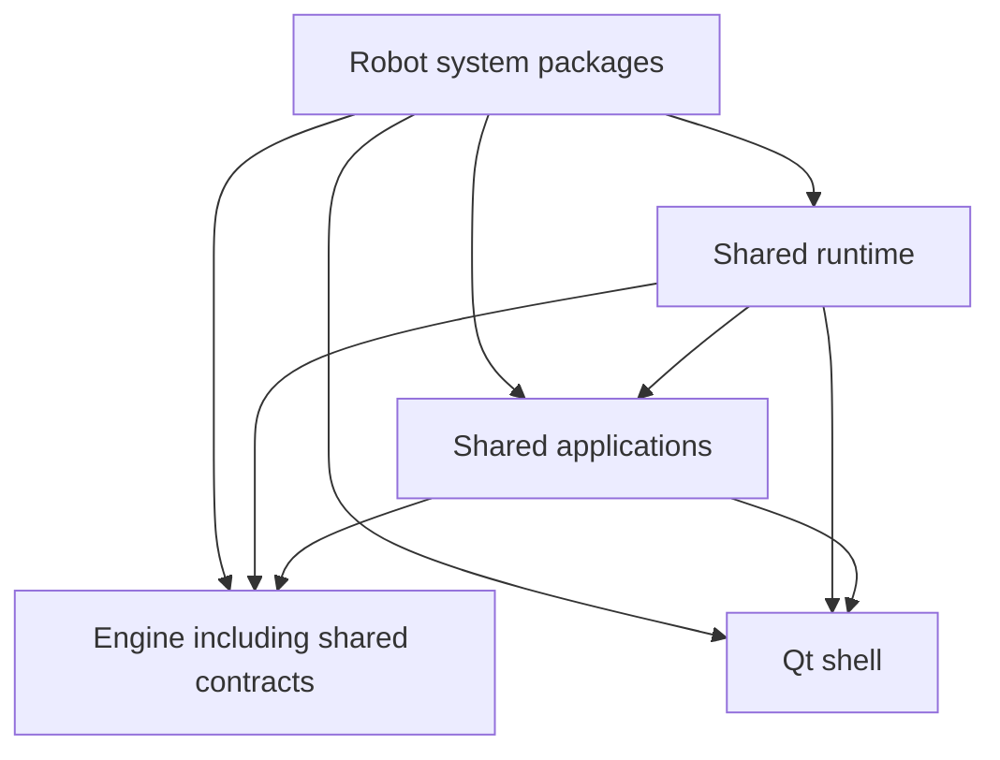

# Preparing the platform for separate repositories

Status: dependency audit and shell packaging pilot implemented. The engine,
applications, shared contracts and robot systems retain their current source
layout and runtime imports. Package/repository names below are target names and
are not yet published distributions. The existing shell pilot metadata still uses
`zeroerr-robot-shell`; renaming it to `pl-robot-shell` is a pending implementation
step, not part of this documentation update.

## Goal and decisions

Keep one repository while establishing independently buildable distributions.
Later, each robot-system repository will install versioned shared packages rather
than copy their source. Use one development environment while components run
together. Keep library dependency ranges in each package and exact deployment
versions in a robot-system lockfile/release manifest. Do not make every MVC screen
an independent distribution.

Distribute engine and shared contracts together as `pl-robot-engine`, with separate
`robot_engine` and `robot_contracts` Python namespaces inside one repository and
wheel. They share a version and release lifecycle. Their existing imports become
internal distribution dependencies rather than a packaging blocker. Preserve
clear module responsibilities without requiring contracts to be independently
installable. Reconsider a separate contracts distribution only if a concrete
consumer needs contracts without the engine or independent releases.

Use the `pl-` prefix for shared platform distributions and system packages.
ZeroErr identifies a replaceable robot driver/backend, so it must not determine
the shared platform's package names.

The first pilot remains the shell: `pl_gui` already has its own import namespace
and does not require engine/system imports.

## Audit findings

See [the generated audit](package_dependency_audit.md) for counts and representative
source locations. Obtain every import site with:

```bash
python scripts/audit_package_dependencies.py --json
python scripts/audit_package_dependencies.py > docs/plans/package_dependency_audit.md
```

The audit is an AST scan, not an execution trace. It includes demos, fallback
imports, imports inside methods and type-checking imports. It resolves relative
imports and discovers robot-system directories automatically. Dynamic import
strings, filesystem access, optional features and native dependencies need
separate review. No source modules are imported by the audit.

The generated audit reports source/module boundaries, so it still lists contracts
and engine separately. For distribution planning, treat their mutual imports as
internal to `pl-robot-engine`; retain the report's separate module evidence.

Concrete blockers and ownership decisions for independent installation:

| Boundary | Evidence | Required migration |
|---|---|---|
| Contracts ↔ engine (internal) | `declarations/system_specs.py` imports `ISettingsSerializer`; `declarations/movement.py` imports/constructs `MovementGroup`; engine uses contracts | Ship both namespaces in `pl-robot-engine`. Preserve behavior and class identity during namespace migration; no import removal is required solely for extraction. |
| Engine → glue | Weight interfaces/factory use glue cell/calibration configuration types | Move reusable weight configuration contracts into the appropriate shared domain; inject glue configuration at composition. |
| Engine demo → glue | `simple_interpolation_pyqt6.py` imports `GlueRobotSystem` | Move the demo to system-owned examples or exclude it from the engine distribution. |
| Shared applications → concrete systems | Calibration/visualizer controllers use glue ProcessID; visualizer service uses glue planning; workpiece editor uses paint config/adapter | Inject application configuration and service abstractions; move concrete adapters/wiring into the owning system. Reassess whether glue-specific visualizer functionality belongs in shared applications. |
| Welding → glue | Calibration process imports glue ProcessID | Define/inject the welding process ID in welding; share actual reusable interfaces separately. |
| Paint variants → paint | `paint_auto_dry` and `paint_tray_dry` reuse paint providers/classes | Ship these profiles with the paint distribution initially. A later profile distribution may explicitly depend on paint; this is intentional reuse, not a dependency to conceal. |
| Bootstrap ↔ system demos | Paint/blueprint runners import shared startup helpers | Keep helpers in a generic runtime package and prevent its launcher from depending on concrete systems. |

Existing `tests/architecture/test_import_boundaries.py` already prevents additions
to its recorded reverse-import debt. Preserve that test and shrink its allowlist
as individual boundaries are repaired. It currently enumerates specific systems;
broaden discovery when new system packages are introduced. The new shell boundary
test independently prevents new platform imports in the pilot.

Additional manually inspected blockers:

- `src/bootstrap/startup_config.py` dynamically loads
  `src.robot_systems.<name>.bootstrap_provider`. Preserve the provider contract but
  later accept an installed package's declared provider, preferably through entry
  points. Configured system selection must continue to work, including profiles.
- `BaseRobotSystem`, `SystemBuilder`, default service builders and
  `RobotSystemBootstrapProvider` live directly under `src/robot_systems/`. They are
  shared framework code and need a shared owner before that directory is split.
- `run_main.py` inserts the checkout into `sys.path`, discovers translations from
  sibling source directories and owns startup orchestration. Move generic startup
  into an installable runtime, with thin system-owned entry points. Preserve Qt
  initialization order, login, role filtering and service lifecycle behavior.
- `startup_config.py` and `ros_backend_launcher.py` refer to repository-relative
  config/backend paths. Make deployment paths explicit before wheel-only startup.
- Shell/shared catalogs currently live under `src/applications/localization/`,
  while app catalogs and system overrides have other owners. Keep catalog layering
  and retranslation behavior; separate read-only packaged catalogs from writable
  language state and machine settings.
- Root `requirements.txt` exists and pins current third-party versions. It covers
  the combined application; the AGENTS.md statement that it does not exist is stale.
  Do not copy this entire file into every package. Derive package requirements from
  used features, then preserve exact tested versions for deployments.
- ROS 2, MoveIt, ros2_control, ament/message packages and native libraries cannot all
  be installed as Python wheel dependencies. Keep their OS/backend provisioning in
  the release workflow and document it per system.
- The source tree includes vendored vision code. Audit its resources, dependencies,
  licensing and packaging ownership before treating engine as a single light
  dependency; hardware/vision extras or adapter packages can follow when justified.

## Proposed distribution ownership

| Distribution | Import namespace | Current sources / responsibility |
|---|---|---|
| `pl-robot-engine` | `robot_engine`, `robot_contracts` | `src/engine` and `src/shared_contracts`; robot/hardware/process/persistence services plus shared declarations, enums and payloads. Clarify reusable versus system-owned glue topics during migration. |
| `pl-robot-shell` | `pl_gui` (preserved) | `pl_gui`; Qt shell, settings framework, shared widgets |
| `pl-robot-applications` | `robot_applications` | Shared MVC screens, application base, touch keyboard and app-owned resources |
| `pl-robot-runtime` | `robot_runtime` | Generic bootstrap plus the four shared system framework modules and `src/robot_systems/__init__.py` exports |
| `pl-paint-system` | `paint_robot_system` | Paint implementation, auto/tray dryer profiles, system-owned applications/configuration |
| `pl-glue-system` | `glue_robot_system` | Glue implementation and its applications/configuration |
| `pl-welding-system` | `welding_robot_system` | Welding implementation and its applications/configuration |
| `pl-twin-system` | `twin_robot_system` | Twin-robot implementation and its applications/configuration |

The runtime is a shared composition/bootstrap package, not a place for concrete
robot-system policy. It may depend on shared applications for login/session setup;
systems depend on it. The engine and shell must not depend on it.



Arrows mean "depends on". This is the target graph, not a claim that the current
repository already satisfies it. Services remain the application integration
seam; packaging does not relax MVC import rules. Each installed system declares
the shared packages it directly imports, even when another dependency also
installs them transitively. An import from either `robot_engine` or
`robot_contracts` requires the same `pl-robot-engine` distribution; there is no
separate contracts dependency.

## Layout when several packages are ready

```text
platform/
  packages/
    engine/pyproject.toml
    engine/src/robot_engine/
    engine/src/robot_contracts/
    shell/pyproject.toml
    shell/src/pl_gui/
    applications/pyproject.toml
    applications/src/robot_applications/
    runtime/pyproject.toml
    runtime/src/robot_runtime/
  systems/
    paint/pyproject.toml
    paint/src/paint_robot_system/
    glue/pyproject.toml
    glue/src/glue_robot_system/
  tests/
  docs/
```

This layout is a destination, not implemented now. Distribution/import names are
distinct: the target shell distribution is `pl-robot-shell`, while Python imports
`pl_gui`. Likewise, installing `pl-robot-engine` provides both `robot_engine` and
`robot_contracts`.
Avoid independently distributing several regular packages under a shared top-level
`src` import namespace: checkout-based resolution can mask missing dependencies and
conflicting installations. Migrate one boundary at a time to stable namespaces.
If temporary compatibility re-exports are needed, they must preserve class/enum
identity; do not load the same source independently under two module names.

## Staged migration and completion gates

1. **Completed now — audit and shell pilot.** The shell has standalone metadata,
   declared Qt dependencies and a `vision` extra for dashboard/camera functionality,
   included image/icon assets, fixed unguarded legacy settings imports, and an
   independent source-distribution → wheel → installed offscreen smoke test.
   Existing dashboard icon/style fallback imports remain recorded legacy code.
2. **Align package names and combined engine ownership.** Rename the shell pilot
   distribution metadata/documentation to `pl-robot-shell` and reverify packaging.
   Define one `pl-robot-engine` project owning both engine and contracts namespaces;
   migrate producers/consumers together when packaging that project. Preserve
   contract/event semantics and class identity. Gate: no separate contracts
   distribution or duplicated contract definitions; shared names are independent
   of the selected robot driver.
3. **Repair engine and shared application reverse imports.** Address each listed
   debt item separately, with targeted stub-based tests. Separate demos from runtime
   distribution where appropriate. Gate: import-boundary debt shrinks and no new
   system-specific imports appear in reusable layers.
4. **Package combined engine/contracts, shared applications and runtime.** Move namespaces and shared
   framework ownership deliberately; include catalogs/assets/default schemas and
   declare extras where imports are genuinely optional. Gate: installed-wheel
   tests outside the checkout, plus existing unit/UI tests, contract/event tests
   and stub composition. The engine wheel must contain both namespaces and import
   without any concrete robot-system sources installed.
5. **Package one robot system.** Start with paint and its profiles because the
   current config selects `paint_tray_dry`. Add a system-owned CLI entry point and
   declared dependencies/provider. Gate: a clean environment installs that system
   plus shared packages and starts its UI with stubs without glue/welding sources.
   Real hardware validation remains an explicit separate step.
6. **Add workspace tooling once multiple packages exist.** Editable installs work
   now; a uv workspace/PyCharm workspace can later track all members with one
   development environment. Back up existing IDE configuration before enabling
   automatic workspace modeling. A workspace is convenience, not a runtime contract.
7. **Extract repositories when desired.** Copy a self-contained package project
   with its tests/docs/CI, build/version its wheel, change local dependency sources
   to released packages, and repeat clean-install verification. No business logic
   rewrite should be needed at this stage.

## Development, releases and machine data

Use editable local installs while developing together. Once released, shared
libraries declare compatible version ranges and each deployed robot system locks
the exact tested set. An internal wheel registry can resolve normal package
dependencies automatically. Pinned Git references are an alternative; avoid
floating branches in deployments. Do not publish any package as part of this pilot.

Keep system entry-point/provider definitions alongside the owning system and avoid
a launcher that eagerly imports every installed system. New systems should need
only shared dependencies and their own adapters; intentionally reusable system
profiles must declare their dependency explicitly.

Bundle immutable icons/catalogs/default configuration using package resources.
Pass writable machine settings/calibration/workpiece/log locations through
configuration; installation directories must not be the machine data directory.
Preserve existing storage locations until a separately tested migration exists.
System-specific factory defaults and backend release profiles must remain scoped
to their system when repositories split.

The shell pilot preserves the current flat layout via an explicit setuptools
package mapping. Its directory is self-contained and can already be copied to a
new repository. Python minimum/dependency ranges in its metadata are proposed
compatibility bounds; this session verifies the current `.venv`, not every supported
Python/dependency combination. CI version-matrix testing should precede a release.

## Verification and references

```bash
.venv/bin/python -m unittest tests.architecture.test_shell_package -v
.venv/bin/python -m unittest tests.architecture.test_import_boundaries -v
python3 -m py_compile scripts/audit_package_dependencies.py tests/architecture/test_shell_package.py
```

The shell packaging test uses a temporary standalone source copy, builds an sdist,
builds a wheel from that sdist, installs without fetching dependencies, verifies
code/assets, and starts shell/settings widgets from outside the checkout with
platform imports blocked. It reuses the current interpreter's installed Qt
dependencies; it does not prove dependency resolution in a fresh environment.

Relevant authoritative references:

- [Python packaging metadata](https://packaging.python.org/en/latest/guides/writing-pyproject-toml/)
- [Setuptools discovery and package mappings](https://setuptools.pypa.io/en/latest/userguide/package_discovery.html)
- [PyCharm workspaces](https://www.jetbrains.com/help/pycharm/python-workspaces.html)
- [uv workspaces](https://docs.astral.sh/uv/concepts/projects/workspaces/)
